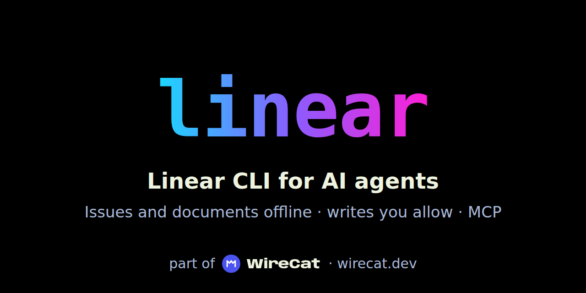

<p align="center">
  
</p>

# linear: Linear CLI and MCP server for AI agents

<p align="center">
  Know what your team is working on without opening Linear. Ask Claude, ChatGPT, Codex or any AI agent, and it
  answers from a copy of your issues, projects and documents on your computer, even offline.
</p>

<p align="center">
  <a href="https://wirecat.dev/en/docs/linear">Docs</a> ·
  <a href="https://wirecat.dev/en/docs/linear/installation">Install</a> ·
  <a href="https://github.com/WireCatLabs/linear-cli/blob/main/docs/usage.md">Usage</a> ·
  <a href="https://discord.gg/DebENqbRrJ">Discord</a>
</p>

<p align="center">
  <a href="https://www.npmjs.com/package/@wirecat/linear-cli"></a>
  <a href="https://github.com/WireCatLabs/linear-cli/blob/main/LICENSE"></a>
</p>

- **Ask instead of clicking.** "What is still open in ENG?" gets an answer in a second, in Claude Code, Codex, Claude
  Desktop or any app that speaks MCP.
- **Your workspace, offline.** Issues, projects, comments and Linear documents are read from your computer, with no
  request to Linear.
- **Writes you allow.** The agent creates, moves and comments on issues as far as the profile lets it, and giving an
  issue to someone else needs a permission of its own.

## What you get

- **The answer, not the search.** Ask about an issue in your own words. The agent finds it by its words or by meaning,
  with its state, assignee and comments.
- **Your open issues as your tasks.** Open issues assigned to you become tasks in WireCat, and close when the issue
  is done or goes to someone else.
- **Issues from the chat.** Create an issue, move it to Done, change its assignee or priority, or add a comment.
- **Documents beside the issues.** Linear documents are copied too, and `memo` finds them with your notes and other
  documents.
- **The whole Linear API too.** Every operation of Linear's API is a command with its own help, for what has no
  command of its own yet.

```text
You:    What is still open on the invoice export?
Agent:  (runs linear work issues search "invoice export", then issues show ENG-12)
        · ENG-12 "Invoice export drops the currency", In Progress, Anna Example
        · ENG-15 "Export invoices as CSV", Todo, no assignee
You:    Move ENG-12 to Done and tell Anna it shipped.
Agent:  (runs linear work issues update ENG-12 --status Done, then issues comments create ENG-12 --text "Shipped")
        ENG-12 is Done, with your comment.
```

*Invented issues, illustrative output.*

## Why linear

- **A copy of your workspace on your computer.** `sync` copies teams, users, states, labels, projects, sprints (Linear's
  cycles), issues and comments into a local store, and the next sync takes only what changed. Lists and search then answer with no
  request to Linear, also offline.
- **A permission on every action.** Each command and each Linear API operation has its own level: allow, ask, read
  only or deny. A delete needs a key of its own.
- **The key stays in your system keyring.** It never appears in output, errors or run records, and is never taken as
  an argument.
- **Your issues beside your other context.** They sit in the same local store as your messages, mail, notes and
  meetings from the other WireCat tools, so one search covers all of them.
- **Free and open source.** Apache 2.0.

## Quick start

In [WireCat Desktop](https://wirecat.dev/en/download), add Linear from the tool list and paste a personal API key
when it asks. Or in a terminal:

```sh
npm install -g @wirecat/linear-cli
linear skill install               # the agent skill, for Claude Code, Codex, Gemini CLI and OpenClaw
linear work session start          # paste your Linear personal API key
linear work sync                   # copy your teams, projects, issues and comments
linear work issues list type:started
```

`work` is a profile, a name you choose for one Linear workspace. It is the first word of every command that uses an
account, and none is ever assumed.

**The API key.** In Linear, open Settings → Account → Security & access and make a personal API key. Read access is
enough to sync. Give it Write if your agent should change issues. `session start` asks for it without showing it and
keeps it in the system keyring.

You need Node.js 22.16 or a later 22.x, or Node.js 24 or later. `linear doctor` needs no network and shows what is set
up.

More: [installation and sign-in, step by step](https://github.com/WireCatLabs/linear-cli/blob/main/docs/installation.md)

## Use it with your agent

Ask in plain words. The agent picks the commands.

> *"Use linear. What did the team finish this week?"*
> *"Use linear. Make an issue in ENG for the broken CSV export and give it to me."*

- **Claude Code, Codex, Gemini CLI** and other agents with a terminal run `linear` themselves.
  `linear skill install` teaches them how.
- **Claude Desktop, Cursor** and other MCP apps connect to the Linear MCP server, `linear work mcp serve`.
- **ChatGPT or Claude in the browser** reach it through your own tunnel, after a login with a one-time code.

```sh
linear work config set permissions.api readonly   # no writes through the API on this profile
linear work mcp add claude-code --allow-writes    # or: codex
linear work mcp config                            # the entry for Claude Desktop, Cursor and others
```

Over MCP nobody is at a terminal to answer a question, so a write set to `ask` goes ahead. Each one is kept as a run in
`linear work runs list`. The first line above keeps the API's writes away from the agent.

More: [agents and MCP](https://github.com/WireCatLabs/linear-cli/blob/main/docs/usage.md#agents) ·
[permissions](https://github.com/WireCatLabs/linear-cli/blob/main/docs/configuration.md#permissions)

## What it can do

### Issues

```sh
linear work issues list assignee:none
linear work issues show ENG-12                        # one issue with its state, assignee and comments
linear work issues search "invoice currency"
linear work issues create --title "Export invoices as CSV" --team ENG
linear work issues update ENG-12 --status Done
linear work issues comments create ENG-12 --text "Shipped in 2.4"
```

### Projects, teams and cycles

```sh
linear work projects list
linear work teams list
linear work sprints list                              # each team's cycles: number, start and end
linear work issues list sprint:<sprint id>            # or sprint:none
```

An issue you move to Linear's trash leaves the copy at the daily check for deleted issues, which the `sync` answer
names under `deletions`: Linear does not mark a trashed issue as changed, so a plain `sync` between those checks still
shows it. Its comments leave with it. An issue you restore from the trash comes back at the next daily check. Issues in
a Duplicate state stay, and `issues list type:duplicate` lists them.

### Documents

```sh
linear work folders add linear:all                    # or one project's id
linear work sync
linear work documents list
linear work search "release checklist"                # by words, and by meaning once indexed
linear work changes --since 7d                        # documents the syncs added, changed or removed
```

A document you move to Linear's trash leaves the copy on the next `sync`, read from the workspace's audit log. A key
without audit-log access gets the warning `source.deletions-unchecked` on each sync, and trashed documents then leave
only with `sync --rescan`. A document you restore from the trash comes back within a week, when `sync` walks the
chosen folders in full, or at once with `sync --rescan`, because Linear does not mark a restore as a change.

### Any Linear API operation

```sh
linear work api list                                  # every operation, without calling Linear
```

More: [every command](https://github.com/WireCatLabs/linear-cli/blob/main/docs/commands.md)

## How it works

- **A personal API key.** You make it in Linear. It is kept in the system keyring, or in a private file on a computer
  without one.
- **A local copy.** `sync` copies the workspace into the WireCat local store, and later syncs read only what changed.
- **Writes go to Linear first.** `issues create`, `update` and `comment` change Linear, then store Linear's copy.
  `--dry-run` shows what a write would send, and sends nothing.
- **Made for scripts.** `--json` prints one JSON value for every command, and an error comes as JSON with a code to
  branch on.

## Settings and permissions

Each profile has a level for every command and every Linear API operation: `allow`, `ask`, `readonly` or `deny`.
Giving an issue to someone other than you is refused unless the profile allows `issues.assign-others`.

```sh
linear work config set permissions.api readonly   # the Linear API reads, never writes
linear work config show                           # each setting and where it came from
```

More: [settings](https://github.com/WireCatLabs/linear-cli/blob/main/docs/configuration.md)

## Security

The key can do what your Linear user can, so `linear` keeps it in the system keyring and never prints it, in output,
errors or run records. Text from Linear is marked as untrusted, so an agent reads an issue as data, not as an
instruction.

More: [security](https://github.com/WireCatLabs/linear-cli/blob/main/docs/security.md) · Report a vulnerability:
[SECURITY.md](https://github.com/WireCatLabs/linear-cli/blob/main/SECURITY.md)

## When something goes wrong

```sh
linear doctor                         # what is set up, without connecting
linear work session status --check    # asks Linear whose key it is
```

More: [troubleshooting](https://github.com/WireCatLabs/linear-cli/blob/main/docs/troubleshooting.md) · Ask on
[Discord](https://discord.gg/DebENqbRrJ) · Bugs go to this repository's
[issues](https://github.com/WireCatLabs/linear-cli/issues).

## Documentation

Everything is in [docs/](https://github.com/WireCatLabs/linear-cli/blob/main/docs/index.md): installation, usage,
settings, security and the command reference.

## Development

You need Node.js 22.16 or a later 22.x, or Node.js 24 or later, and pnpm.

```sh
pnpm install && pnpm test
```

Every operation is tested against a strict fake built from Linear's API description, with invented records, and
nothing reaches a real workspace. The CLI was started from [cli-template](https://github.com/WireCatLabs/cli-template).

More: [design](https://github.com/WireCatLabs/linear-cli/blob/main/docs/dev/DESIGN.md) ·
[working rules](https://github.com/WireCatLabs/linear-cli/blob/main/AGENTS.md)

## Part of WireCat

`linear` is one of the [WireCat](https://wirecat.dev) tools: open-source, local-first command-line tools that give AI
agents your context from messengers, mail, calendars, CRMs and documents. Each one works on its own.

## License

[Apache 2.0](https://github.com/WireCatLabs/linear-cli/blob/main/LICENSE)
